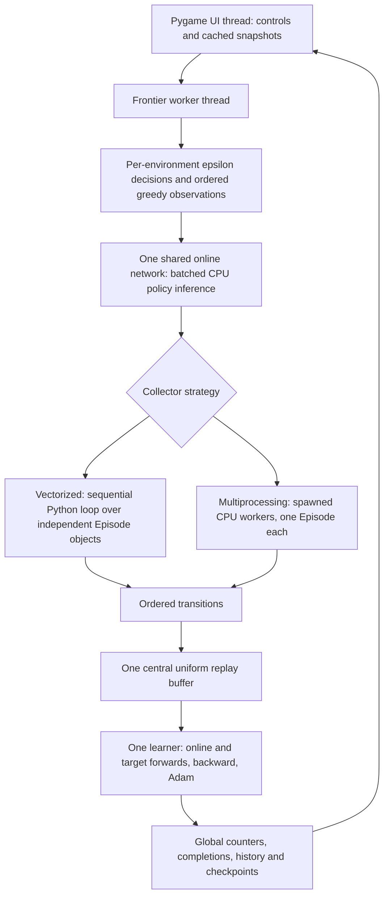

# SnakeInfinite v1.5.3 — Parallel Frontier Training Audit

Audit date: **2026-11-04**. This is an audit of the existing release, with no public
version change and no production repairs.

## A. Executive verdict

**FAIL — confirmed defects require repair before stable release.**

Normal independent collection, batched inference, replay, global schedules,
requested episode targets and ordinary checkpoint continuation pass the tested
contracts. However, an exception inside a vector batch can publish a recovery
checkpoint that cannot resume, and completed episodes from that interrupted batch
can disappear from the durable history. These are release blockers in recovery
and accounting, not evidence that normal CNN learning is inherently incorrect.

Prioritize the small recovery/history repairs below before proceeding with the
Model Library implementation or calling v1.5.3 stable. Model Library design work
is separable, but no implementation is started by this audit.

**Frontier is the training interface, not a model architecture.** The audit uses
Alpha (A, original 11-input MLP, 355 parameters), Distance (B, default 19-input MLP,
3,459), CNN (C, binary body, 188,419), and oCNN (D, ordered body, 188,419).
Performance measurements cover the requested Alpha/Distance/CNN matrix; oCNN is
included in functional, resume and frozen-weight verification.

## B. Architecture and concurrency



`FrontierWorker._run` creates `ParallelTrainer` when count >1, strategy is
multiprocessing, or vector-step updates are selected. The original one-environment
reference path remains `Trainer`. `ParallelTrainer` passes the configured count
to `EnvironmentPool`; it creates that many independent `Episode`/`Game` instances
or child processes. Count is applied; multiple objects do not imply multiple CPU
cores in the default collector.

- **Auto → vectorized:** `EnvironmentPool.step` uses a sequential `for` loop in
  the learner process. There is no NumPy-vectorized physics, environment thread
  pool, or simultaneous Python simulation. Python's GIL and the explicit loop
  serialize that work. The UI is a separate thread and can still compete for the
  interpreter while numerical Torch operations release the GIL.
- **Multiprocessing:** Windows `spawn` children can execute environment Python
  concurrently and bypass a shared GIL. Parent sends actions, then receives in
  fixed environment-ID order. Each batch is a barrier: no collector/learner
  overlap or asynchronous actor pipeline exists. Workers contain neither network
  copies nor optimizer, Torch or Pygame imports in tested spawn entry points.
- **Learner:** `ai/frontier.py:96` explicitly sets `torch.set_num_threads(1)`.
  There is one central optimizer and no simultaneous learning across workers.
  Torch inter-op setting was 8 in measured processes, but intra-op was 1. One
  fully occupied logical CPU is about 100% in process metrics, or roughly 6.25%
  when averaged over 16 logical processors. Low machine-wide CPU utilization is
  therefore expected for a serial learner, not proof of inactive environments.

Greedy subsets are batched as `[B,11]`, `[B,19]`, or separate spatial
`[B,3,25,25]` and heading `[B,4]` tensors. Per-slot RNGs independently decide
exploration and random actions. The returned actions map back to those exact
environment IDs. All policy actions in a vector batch use pre-update weights.

Only the learner thread inserts replay transitions and samples replay; no shared
replay mutation occurs in child processes. Reference mode performs one optimizer
update per inserted transition after warmup. The explicitly labeled vector-step
mode performs one per vector batch and is a different update/data ratio. The audit
matrix uses only the reference ratio to hold workloads equal.

Global steps count every transition exactly once. Epsilon uses global steps plus
the transition's within-batch offset. Target sync checks exact global transition
multiples, including non-divisible thresholds inside a batch. Completion indices
follow result order; per-environment local sequence and deterministic SHA-256
episode seed are recorded. The scheduler reserves remaining target slots and
limits milestone batches, so tested completion targets do not overshoot.

Pause applies between batches and retains partial states. Normal parallel save
captures a quiescent boundary; resume rebuilds partial games from seeds/action
traces and restores learner/Adam/replay/RNG/counters. Stop releases children;
in-memory resume reconstructs them. Faults inside that boundary protocol are the
defects described below.

## C. Controlled CPU benchmark matrix

Hardware verified locally: AMD Ryzen 7 6800H, **16 logical processors**. Windows,
Python 3.13.12, Torch 2.15.0+cpu, one intra-op thread. Physical eight-core/GPU/VRAM
details are supplied project context; GPU execution and hardware trace profilers
were not used. Initial restricted WMI access failed; registry/native process
queries supplied the CPU identity and competing-process evidence.

**Measurement qualification:** the user closed SnakeInfinite, and no Python
processes were observed before starting this repeat. The tables below now use
the game-closed run. Other OS activity, CPU temperature and clock speeds remain
uncontrolled; three short trials do not establish precise hardware speedups.
The earlier CPU-active-game matrix is retained as separate evidence.

The matrix has **144 trials**: 3 families × 4 counts × 2 strategies × 2 modes ×
3 repetitions. Seeds are 7/8/9; model/count order reverses in the middle repetition.
Every trial warms up for **128 transitions** before timing. Environment-only mode
then measures **4,096 transitions**; full training measures **256 transitions and
256 actual optimizer updates**. All requested counts were fully active in every
measured batch. Per-environment timed budgets are exactly 4,096/N and 256/N.

Full training retains Adam .001, gamma .99, batch 64, replay capacity 100,000,
target interval 1,000, rewards and clipping. **Epsilon is held at .05 for every
cell**, explicitly modeling post-decay greedy-heavy action selection rather than
allowing a short epsilon≈1 pilot to avoid almost all neural inference. This is a
performance workload, not a trained-policy or quality comparison. Original
one-environment seed semantics remain different from the parallel seed scheme;
identical trajectories across counts are not claimed.

Environment-only actions come from independent seeded `random.Random` streams
and uniformly sampled relative actions. Inference and optimization are excluded.
It collects encoder-native observations; CNN dense float grids are materialized
later during neural batching, so that cost appears in the training profile.

Timed work totals **313,344 transitions and 18,432 optimizer updates**, over
**148.43 measured seconds**, with zero trial/worker failures. Including warmup,
the matrix executes **331,776 transitions and 23,112 optimizer updates**. Startup,
shutdown, checkpoint I/O and report writing are outside timed loops. Training
replay occupancy is only 384 transitions at trial end; long-run 100,000-entry
replay locality/memory and learned long snakes are not represented.

Raw data for every repetition, actual seconds/counts, CPU/RAM, per-environment
rates and stage counters are provided in
[game-closed CSV](data/v1.5.3-parallel-audit-game-closed-trials.csv) and
[game-closed JSON](data/v1.5.3-parallel-audit-game-closed.json).
The original [concurrent-game CSV](data/v1.5.3-parallel-audit-trials.csv) and
[JSON](data/v1.5.3-parallel-audit.json) remain available; they are not pooled into
the new medians.

The tables show **median**, with **min–max in parentheses**, across three trials.
Training steps/s equals optimizer updates/s here because the measured ratio is
exactly 1.0. CPU percentages include parent and owned children; 100%=one core.
RAM is the median parent end working set plus sum of child process peak working
sets, an upper-bound mixture rather than a simultaneous whole-run peak.


### Alpha

| Envs | Strategy | Environment-only transitions/s (range) | Per-env transitions/s | DQN transitions/s = updates/s (range) | Completed episodes/s | DQN CPU % | Approx. RAM MiB |
| ---: | --- | ---: | ---: | ---: | ---: | ---: | ---: |
| 1 | vectorized | 30,660.2 (30,401.9–31,315.8) | 30,660.2 | 666.3 (612.3–679.0) | 7.81 | 100.9 | 322.9 |
| 1 | multiprocessing | 7,210.3 (7,027.8–7,539.3) | 7,210.3 | 574.3 (564.0–594.2) | 2.32 | 99.8 | 346.5 |
| 2 | vectorized | 32,375.1 (31,965.9–32,586.2) | 16,187.6 | 727.0 (697.7–727.0) | 2.84 | 97.6 | 322.9 |
| 2 | multiprocessing | 11,642.3 (11,459.1–12,115.7) | 5,821.2 | 638.7 (611.2–647.4) | 2.53 | 108.2 | 369.9 |
| 4 | vectorized | 33,245.4 (32,488.5–33,499.3) | 8,311.3 | 712.8 (659.9–758.1) | 2.78 | 100.7 | 323.2 |
| 4 | multiprocessing | 18,404.5 (17,757.3–18,510.6) | 4,601.1 | 660.9 (657.4–662.8) | 2.59 | 117.3 | 418.6 |
| 8 | vectorized | 33,842.8 (33,786.1–34,121.0) | 4,230.3 | 762.0 (733.1–767.6) | 6.00 | 98.4 | 322.3 |
| 8 | multiprocessing | 24,278.4 (23,851.2–25,483.6) | 3,034.8 | 704.0 (672.8–709.1) | 5.50 | 155.8 | 512.7 |

### Distance

| Envs | Strategy | Environment-only transitions/s (range) | Per-env transitions/s | DQN transitions/s = updates/s (range) | Completed episodes/s | DQN CPU % | Approx. RAM MiB |
| ---: | --- | ---: | ---: | ---: | ---: | ---: | ---: |
| 1 | vectorized | 27,400.2 (27,165.9–27,562.8) | 27,400.2 | 650.4 (573.0–658.2) | 5.14 | 99.2 | 322.2 |
| 1 | multiprocessing | 6,998.4 (6,721.0–7,084.3) | 6,998.4 | 548.8 (531.6–553.5) | 2.14 | 108.1 | 346.0 |
| 2 | vectorized | 29,233.6 (28,261.0–29,426.0) | 14,616.8 | 655.4 (624.2–679.6) | 2.65 | 99.5 | 321.9 |
| 2 | multiprocessing | 11,245.0 (11,025.8–11,799.1) | 5,622.5 | 594.4 (585.5–599.6) | 2.34 | 113.5 | 369.7 |
| 4 | vectorized | 29,873.2 (29,089.4–29,936.4) | 7,468.3 | 699.7 (653.6–703.2) | 2.75 | 98.2 | 322.0 |
| 4 | multiprocessing | 17,298.5 (15,310.0–17,718.0) | 4,324.6 | 624.0 (610.8–651.6) | 2.55 | 134.2 | 417.2 |
| 8 | vectorized | 30,540.3 (30,075.6–30,734.5) | 3,817.5 | 721.1 (702.8–723.3) | 8.24 | 101.5 | 322.1 |
| 8 | multiprocessing | 23,158.5 (22,560.2–23,541.0) | 2,894.8 | 657.8 (636.4–662.4) | 7.46 | 128.5 | 511.6 |

### CNN

| Envs | Strategy | Environment-only transitions/s (range) | Per-env transitions/s | DQN transitions/s = updates/s (range) | Completed episodes/s | DQN CPU % | Approx. RAM MiB |
| ---: | --- | ---: | ---: | ---: | ---: | ---: | ---: |
| 1 | vectorized | 43,862.9 (42,031.9–44,473.0) | 43,862.9 | 53.3 (53.1–56.2) | 0.00 | 100.0 | 344.4 |
| 1 | multiprocessing | 7,291.9 (7,129.3–7,815.4) | 7,291.9 | 53.7 (53.0–54.0) | 0.62 | 99.7 | 374.1 |
| 2 | vectorized | 46,573.3 (45,723.2–47,144.7) | 23,286.7 | 54.9 (54.7–55.1) | 0.65 | 99.8 | 351.3 |
| 2 | multiprocessing | 9,966.6 (9,619.2–12,309.2) | 4,983.3 | 53.7 (50.5–54.2) | 0.63 | 100.5 | 405.3 |
| 4 | vectorized | 49,467.8 (45,640.7–49,548.8) | 12,367.0 | 55.0 (47.1–55.4) | 0.74 | 99.8 | 342.6 |
| 4 | multiprocessing | 17,868.7 (16,548.1–17,993.7) | 4,467.2 | 54.4 (54.3–55.7) | 0.85 | 101.6 | 441.7 |
| 8 | vectorized | 50,943.6 (49,948.5–53,358.3) | 6,368.0 | 56.4 (55.0–57.2) | 1.29 | 99.5 | 346.0 |
| 8 | multiprocessing | 24,611.4 (23,510.3–24,768.3) | 3,076.4 | 55.9 (55.2–56.4) | 1.31 | 103.1 | 541.1 |

### Stage measurements

The following stages are exclusive parent wall times, median milliseconds per
256-transition training trial. Child service times are separate sums, can overlap
parent wait, and must not be added to parent wall time. Complete stage data for
all 24 model/count/strategy combinations remain in the raw files. Target sync is
not triggered in these short measured windows (global steps 128→384, interval
1,000); correctness is separately tested across non-divisible sync thresholds.

| Family / vectorized count | Observation access / encoding ms | Tensor prep ms | Replay sample ms | Policy forward ms | Online + target training forward ms | Backprop ms | Adam ms | Dynamics ms |
| --- | ---: | ---: | ---: | ---: | ---: | ---: | ---: | ---: |
| A / 1 | 11.16 | 27.74 | 5.36 | 21.61 | 50.30 | 45.64 | 72.41 | 5.70 |
| A / 4 | 6.09 | 26.31 | 5.74 | 5.37 | 51.33 | 46.74 | 73.66 | 4.49 |
| A / 8 | 5.11 | 23.61 | 5.21 | 2.74 | 49.75 | 44.37 | 70.67 | 3.63 |
| B / 1 | 7.56 | 36.85 | 5.21 | 19.91 | 51.64 | 47.49 | 73.68 | 6.13 |
| B / 4 | 6.10 | 36.99 | 5.20 | 5.40 | 51.14 | 47.50 | 73.61 | 4.79 |
| B / 8 | 5.71 | 36.32 | 5.23 | 2.76 | 51.03 | 46.49 | 72.41 | 4.10 |
| C / 1 | 5.99 | 94.36 | 8.56 | 93.18 | 1975.68 | 1827.16 | 270.89 | 12.07 |
| C / 4 | 3.04 | 91.29 | 9.15 | 48.80 | 1957.27 | 1796.48 | 270.44 | 6.11 |
| C / 8 | 2.39 | 88.87 | 8.96 | 29.51 | 1908.17 | 1756.96 | 267.99 | 4.56 |

**Timing limitations:** observation access includes encoder caching/lookups;
tensor prep includes observations plus action/reward/mask tensors. Stage sums do
not cover every validation/Python bookkeeping operation. Parent counters are sampled before end-of-trial telemetry, so receive timing
excludes those replies. Child service sums overlap parent waiting and are not
added to parent wall time. The tool includes an explicit target-sync timer. Neither IPC-only CPU cost nor GIL wait nor
cache/memory-stall cycles were measured with a hardware profiler.

## D. Bottleneck diagnosis and DQN correctness

Ranked confirmed observations:

1. **CNN learning kernels dominate.** Four-environment vectorized CNN trials spend
   80.3–80.6% of wall time in online/target training forward and backward.
   In the first trial: 0.977 s online forward +
   0.981 s target forward + 1.796 s backward
   out of 4.658 s. Adam adds 0.270 s and clipping
   0.098 s. Dynamics plus observation access total only
   0.0091 s. Faster simulation
   cannot remove the serial neural workload.
2. **One update per transition maintains the same expensive learning workload.**
   Eight environments produce eight transitions followed by eight reference
   optimizer updates. More collector objects do not divide those updates among
   eight learning cores. The user's near-equal ~300k transitions/~300k updates and
   ~38.7 steps/s/~38.7 updates/s match the documented reference semantics.
3. **Multiprocessing adds communication and barriers to cheap physics.** It can
   increase its own simulation throughput with count, but is slower than local
   collection for every family/count in the environment-only medians. No actor/
   learner overlap exists. Receive wait includes useful child work and transport;
   it is not proof of Python GIL contention or IPC CPU overhead alone.
4. **Batched policy inference has workload-dependent benefits.** Median Alpha
   reference throughput changes from 666 to 762 steps/s at eight vectorized
   environments; Distance medians span 650–721. CNN medians
   stay around 53.3–56.4 steps/s. These short measurements
   support measured count selection, not a universal speedup guarantee.
5. **Validation/tensor materialization/bookkeeping are secondary measured costs.**
   Compact spatial replay materializes dense minibatches twice per update.
   Finite-value checks and Python overhead are visible in unassigned time, but
   their individual contributions were not isolated. Memory bandwidth or thread
   oversubscription remains a hypothesis, not a confirmed primary bottleneck.

Correctness findings:

- All tested 1/2/4/8 local states have distinct board, body, snake and RNG objects.
  A forced apple, score change, collision, reward or reset in one does not alter
  the others. Stagnation and collision resets are verified separately.
- All three requested encoders, counts and both collectors match independent
  seeded Episode oracles transition-for-transition while environments advance
  and reset at different times. No cross-environment action/reward/state
  contamination was found. Identical starting positions are intentional; mutable
  state is independent.
- Returned actions/replay entries have the correct association and terminal/
  truncation flags. Global step/epsilon/target checks and exact completion targets
  pass. Sampling remains owned uniform replay; there is one optimizer.
- CNN geometry/channel/heading conventions remain consistent with registered
  schemas. Relative outputs map 0=straight, 1=left, 2=right. No obvious encoding or
  action-mapping defect was found. This does not certify that CNN learning quality
  is good or that the representation/hyperparameters are optimal.
- Normal checkpoints preserve online/target, Adam moments, epsilon, RNG, replay and
  counters in tested configurations. Additional A/B/C/D checks compare Adam state
  tensors and counters exactly after partial resume. Frozen evaluations repeat
  seed 17 with identical trajectories and unchanged weights, with gradients
  disabled. Historical compatibility is covered by existing regression checks;
  no historical trained checkpoint was resumed for learning in this audit.

Poor CNN scores alone do not demonstrate a parallel-system defect. Dense spatial
learning, sparse rewards and representation/capacity/sample-efficiency questions
belong to later intelligence research, not speculative changes in this audit.

## E. Prioritized defect register

### AUD-01 — High — blocks v1.5.3 stable release

**Affected:** `ai/parallel.py:69–112`, `ai/frontier.py:332–339`,
`ai/checkpoints.py:65–108`.

**Reproduction:** run four environments, episode cap 1, replay batch 2; inject an
exception on the second `ParallelTrainer.optimize` call. The first transition
finishes one episode. The next terminal transition has already appended its trace
and mutated replay/global counters when optimization raises. `at_boundary` remains
true, and terminal-slot cleanup at line 102 has not executed.

**Evidence:** Frontier reports **“recovery saved at last committed vector state”**.
Its checkpoint contains an active terminal trace. Resuming raises
**`ValueError: Active episode trace is terminal`** at `ai/parallel.py:148`.
`FrontierStore.save` validates model weights with `load_model`, not recovery state.
The ordinary contract test fails under `--runxfail`; strict xfail records the known
defect until repaired. This is a failure-injection result, not a claim that a
normal healthy batch spontaneously corrupts checkpoints.

**Proposed repair:** track whether learner state is at a safe committed vector
boundary; disallow publishing recovery from an interrupted unsafe batch. Preserve
and report the previous verified checkpoint, or explicitly state recovery is
unavailable. Validate recovery-state invariants before promoting a pointer and
claiming successful recovery. Never imply exact rollback after a partially applied
optimizer failure. A robust batch transaction/rollback is a larger alternative,
not a required broad rewrite for the small repair.

### AUD-02 — High — blocks v1.5.3 stable release

**Affected:** `ai/frontier.py:289–315`, `ai/parallel.py:102–111`.

**Reproduction:** use the same interrupted second optimization. Completion for
environment 0 is already appended and `trainer.completed` is 1. Frontier records
completion objects only after `train_batch` returns; the exception bypasses that
entire block. Error handling flushes only records already in the journal queue.

**Evidence:** failed-session metrics report **one completed episode** while
`HistoryStore(...).load(...).records` has **zero** records. Thus checkpoint counters,
Analysis and CSV can disagree about actual completed work. The second strict
contract test confirms `assert 0 == 1` when expected-failure handling is disabled.

**Proposed repair:** drain each committed completion exactly once even when a
batch raises, before flushing/history/status handling. Use completion index to
prevent duplicate writes and synchronize failure metrics with committed counters.
Keep terminal/trace validity consistent with AUD-01. Avoid per-step SQLite commits;
the existing buffered history can be retained.

### AUD-03 — Low — nonblocking for parallel correctness

**Affected:** existing `tests/test_arcade_ui.py:199–210`, with
`services/video.py:78–85` synthetic-time waiting behavior.

**Reproduction/evidence:** the first combined suite failed the real-video test
with “did not produce a first frame within 10 seconds”; it passed in isolation in
1.47 s and on the complete recheck. The test advances .04 simulated seconds every
.002 wall seconds: a nominal ten-second startup wait can expire after roughly
half a wall second before a cold decoder/import is ready. This is a timing-
sensitive harness issue; it is not evidence that the parallel collector breaks
video. A production ten-real-second decoder failure was not reproduced.

**Proposed repair:** separately align test elapsed time with real wall time or
wait on a bounded decoder-ready condition, and always close video in a `finally`
block. Do not change video playback behavior as part of the training repair.

## F. Repair plan for approval

1. **Mandatory, narrow v1.5.3 correctness repair:** add a truthful safe-boundary
   state; prevent unsafe recovery publication and retain the previous verified
   recovery pointer; drain committed completion records on failure exactly once;
   make failure counters/history and recovery messages agree. Extend failure
   tests to pre-collection, partial collection, before/after optimizer mutation,
   terminal cleanup and history flush. Convert AUD-01/02 xfails to passing tests
   only after the actual contracts are repaired.
2. **Small, low-risk followups:** isolate/fix the video test's synthetic clock;
   separate actual policy samples from forward-batch counts in profiler labels;
   retain explicit updates/transition and count settings. Profile finite checks
   and tensor construction before reducing safety checks. No unmeasured hot-path
   change is recommended solely on intuition.
3. **Defer CPU/CUDA optimization:** measure Torch intra-op thread choices, CNN
   forward/backward kernels, tensor materialization, CPU/GPU crossover, transfers,
   and only then device selection or actor/learner pipelining. More environment
   processes will not fix a serial optimization bottleneck. CUDA remains outside
   this audit.
4. **Defer CNN intelligence investigations:** representation comparisons, gradient/
   Q-value diagnostics, reward/sample efficiency and interpretability belong to
   Neural Laboratory/intelligence research. Do not change architectures, reward
   definitions or DQN objective to mask an infrastructure issue.

This plan is proposed for approval. **No production repairs, Model Library work,
CUDA implementation, or neural architecture changes have been made.**

## G. Verification log and limitations

- Initial audit-fixture run: 18 pass, 18 fail, 2 xfail. The new asynchronous test
  incorrectly demanded different episode lengths while applying the same
  stagnation limit; oracle transitions already matched. The fixture was corrected
  to assert different completion times under independently stepped clocks. This
  was diagnostic test code, not a production repair.
- Corrected audit contract suite: **36 passed, 2 strict xfailed**, 10.68 s.
- Known defect reproduction with `--runxfail`: **2 failed**, 7.06 s, with exact
  terminal-trace and missing-history evidence preserved in local JUnit XML.
- First full suite: **466 passed, 1 video test failed, 2 xfailed**, 77.26 s.
- Isolated video recheck: **1 passed**, 1.47 s.
- Full suite recheck: **467 passed, 2 strict xfailed**, 70.60 s. Expected failures
  are confirmed defects, not release-readiness passes.
- Instrumentation smoke: 8 short Alpha/local trials completed; 8 short Alpha/spawn
  trials completed after the telemetry-window refinement. Neither smoke is mixed
  into the 144-trial matrix or its aggregate performance claims.
- Initial matrix and game-closed repeat: **144 completed trials each, zero
  worker failures**, exact budgets and
  requested/active counts, three repetitions per cell, update ratio 1.0.
- Extra A/B/C/D frozen/resume script: all four retain exact optimizer/counters,
  repeat seeded trajectories and leave frozen weights unchanged.
- Read-only protection audit: **215 pre-existing historical files unchanged**;
  **71 production Python files unchanged**. The original version remains v1.5.3.
- The game-closed repeat was completed after the user exited the application.
  No thermal-controlled run, GPU/CUDA profile, full 500-game quality evaluation,
  long-duration soak, full replay-capacity test, or packaged-Windows build was
  performed. No inference is made about those untested conditions.

Reproduction commands (use isolated profile environment variables for tests):

```powershell
.\.venv\Scripts\python.exe tools\audit_parallel.py --steps 256 --environment-steps 4096 --warmup 128 --repeats 3 --output .artifacts\audit-new.json
.\.venv\Scripts\python.exe -m pytest -q tests\test_parallel_audit.py -rx
.\.venv\Scripts\python.exe -m pytest -q tests\test_parallel_audit.py -k "recovery_claim or completed_counters" --runxfail
```

Added repository instrumentation/report files:

- `tools/audit_parallel.py`: diagnostic wrappers for production episodes, collectors,
  policy/training forwards, replay, tensor prep, backward, gradient clipping, Adam,
  waits, resets and CPU/RAM; spawned diagnostic children retain the production
  protocol. Temporary instrumentation is removed when each trial ends.
- `tests/test_parallel_audit.py`: deterministic independence/oracle/schedule checks
  and two strict expected-failure contracts. No failures are silently skipped.
- This audit report and its raw CSV/JSON data. Additional local protections, XML,
  diagnostic checkpoints and frozen-verification results are isolated under
  `.artifacts/v153-audit/`; they are not historical model replacements.

No files were staged, committed, pushed, tagged or published. No Git-state-changing
operation was performed. The user closed the application before the repeat; the audit did not stop or
modify user processes.
